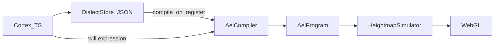

# Organic pipeline: Cortex → Compiler → Soma

Fluxa densifies thought the way living systems densify reflex: soft high-level code (ARN) is burned into fixed-width somatic bytecode (protein), then the GPU runs pure impulse.

## Three worlds (inside `@fluxa/core`)

| World | Path | Role |
| --- | --- | --- |
| Cortex | `expression/cortex.ts`, `dialogue/`, `cognition/` | LLM, vault matter, Meta-AEL AST macros, speech |
| Compiler | `expression/compiler/` | Expand invokes → 16-byte instructions + string pool |
| Soma | `sim/`, `shaders/`, `gl/`, `ripple/` | 60 FPS WebGL; typed upload buffers |

React / DOM stay thin hosts. The cortex never paints thought through DOM components; the only body outlet is `executeExpression` / `executeProgram`.

Volonte / organe vivant : [`manifeste-symbiose.md`](manifeste-symbiose.md) (`FluxaWillEngine`, macro `living_panel`).



## Bytecode (palier 1.5)

Instruction = 16 bytes LE:

```
opcode:u8 | flags:u8 | pad:u16 | f0:f32 | f1:f32 | f2:f32
```

Opcodes: `RIPPLE=1`, `INK=2`, `ORGANITE=3`, `FIELD=4`, `UTTER=5`. No `INVOKE` after compile.

- Header: magic `AEL1` + instruction count
- `utter` text lives in a parallel string pool (index in `pad`)
- Macros stay JSON in `localStorage` (`fluxa.dialect.v1`); bytecode is an in-memory cache rebuilt on register/load via `DialectStore.getProgram(name)`

## Hot path

1. Cortex builds `AnimaExpression` (AST, readable for LLM).
2. Soma calls `compileExpression` (or cached `getProgram` for bare `invoke`).
3. `executeProgram` drives `enqueueRipple` / `spawnOrganite` / … with zero string op tags.
4. Each frame, organite/ink slots pack into `Float32Array` and upload with `uniform4fv` / `uniform2fv`.

Debug fallback: `FLUXA_AEL_AST=1` or `globalThis.__FLUXA_AEL_AST__ = true` reverts to AST interpret.

Self-test: `pnpm --filter @fluxa/core test:compiler`

## Paliers

| Palier | Status |
| --- | --- |
| 1 Meta-AEL JSON macros + expand | shipped |
| **1.5 bytecode + typed soma buffers** | this doc |
| 2 live GLSL compilation | later |
| 3 DOM `FluxaComponent` spawning | later |

See [`anima-expression.md`](anima-expression.md), [`cognition.md`](cognition.md).
